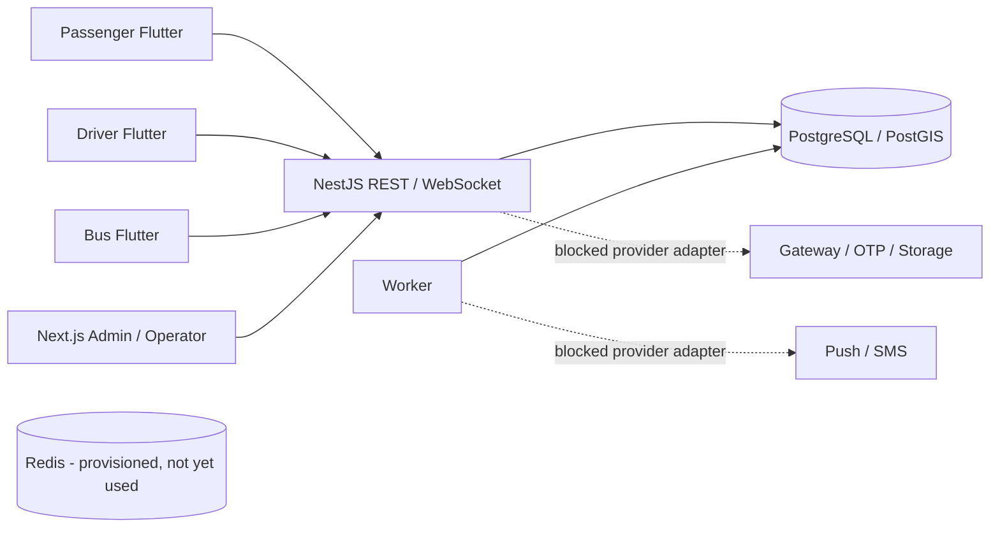
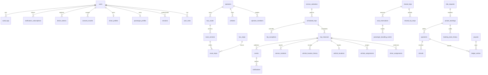
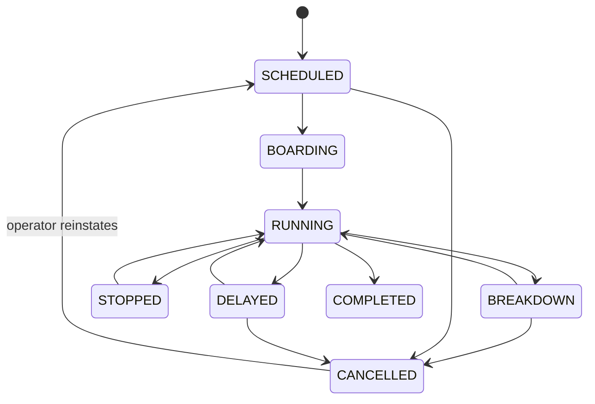
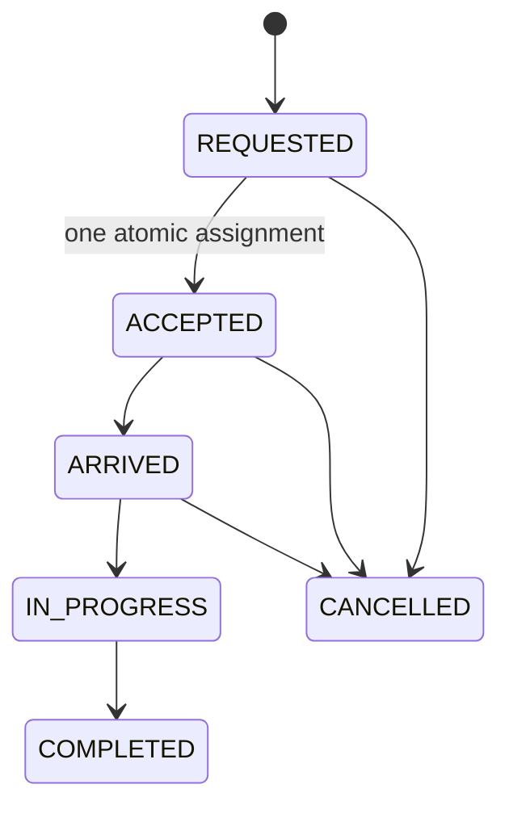

# Architecture and design decisions

Status: initial architecture, 18 October 2026. Scope/evidence: DELIVERY_STATUS.md.

## ADR 001 — Modular monorepo and shared backend

Three independently branded Flutter applications depend on mobile_core by path during development; extract/version that package before independent releases. Next.js is the operator/admin surface. A single NestJS REST API controls persistence, authorisation and trip transitions. Node 24 LTS; NestJS 12.1.3 and Next.js 16.4.2 were verified against the package registry. Dependencies are locked in pnpm-lock.yaml. Flutter dependencies resolved and locked with Flutter 3.47.7 / Dart 3.13.5.

## ADR 002 — PostgreSQL and explicit SQL

Use node-postgres and parameterised SQL instead of Prisma for clear PostGIS access and explicit transactional locks. Each mutating service runs in a database transaction. Shared reservations lock the trip row, then compute overlapping segment occupancy before insertion. A unique active reservation per passenger/trip and foreign keys enforce additional invariants. Native PostgreSQL concurrency tests remain mandatory even after embedded tests pass.

## ADR 003 — Identity and tenancy

Opaque 256-bit access/refresh tokens are stored as SHA-256 digests. Access lasts 15 minutes. Refresh tokens rotate; reuse revokes the session. Role grants originate from database records, never login payloads. Every operator mutation checks membership or administrator role. Bus crew must have an explicit trip assignment. Production OTP onboarding and admin MFA are release blockers. Sandbox OTP is limited to pre-seeded accounts and non-production environments.

## ADR 004 — Events and degraded connectivity

Status changes, incident records, audit rows and events commit together. Events are monotonic database IDs with versioned topic/payloads. WebSockets poll the durable event table every two seconds; mobile also refetches every five seconds, reconnects with a cursor, and tolerates duplicate IDs. Event versions detect stale writes. This is a small-scale reliable foundation; Redis fan-out and bounded retention require load testing before scaling. Admin explicitly uses five-second refetch, not a claimed live socket.

## ADR 005 — Honest location and time

Store WGS84 geography with GiST indexes and timestamped fixes. Reject coordinates older than two minutes, more than ten seconds in the future, out of order, or implying speeds above 55 m/s. Live display expires at 60 seconds and is suppressed outside active states. No map matching or computed ETA is claimed. Device clocks, accuracy and rural road travel require field validation. Foreground-only location is an intentional first slice; background permissions are a later release gate.

## ADR 006 — External integrations

Production OTP, gateway/UPI, FCM, object storage/scanning and maps are unavailable without credentials and provider selection. The API fails closed instead of manufacturing success. Notification inbox rows persist but worker marks AWAITING_PROVIDER. Cash recording only occurs after driver-confirmed completed bookings; ledger writes balance to zero in one transaction and rows cannot be updated/deleted. Gateway reconciliation, refunds and payouts remain incomplete.

## Components

## Entity relationship diagram

The SQL migrations are authoritative. Additional model tables exist for documents, fare quotes/policies, ratings, complaints and support tickets. Schema existence is not a claim that the corresponding workflow is implemented.

## State diagrams

Additional permitted edges are explicit in domain.ts. COMPLETED is terminal. Optimistic version checks apply to status changes.

Shared trips: DRAFT → PUBLISHED → BOARDING → IN_PROGRESS → COMPLETED; PUBLISHED/BOARDING → CANCELLED. Current creation directly publishes after validation; a draft editor is pending. Reservations: CONFIRMED → CANCELLED or BOARDED → COMPLETED; NO_SHOW/EXPIRED processing remains partial.

## Target graph planner (not implemented)

Represent stop/corridor nodes with scheduled ride edges, shared-service edges, walking connections and private first/last-mile connectors. Use time-dependent earliest-arrival search, accessibility filters and fare/duration/Pareto ranking. Ingest imperfect rural schedules with provenance and service-day exceptions. Confidence carries SCHEDULED/ESTIMATED/LIVE source and freshness. Do not manufacture distance, transfers, ETAs or road routes from straight-line distance. GTFS adapters and multimodal planner are not started.
